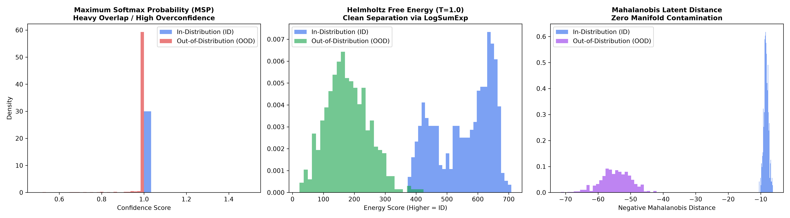

<div align="center">

# 🔬 Deep OOD Benchmark: Energy & Latent Anomaly Scoring

**Benchmarking Out-of-Distribution (OOD) Detection & Softmax Distortion Mitigation in PyTorch**

[](https://www.python.org/)
[](https://pytorch.org/)
[-brightgreen)](#-empirical-benchmark-results)
[-success)](#-empirical-benchmark-results)
[](LICENSE)

<p align="center">
  <a href="#-the-failure-mode-softmax-distortion">Theoretical Defect</a> •
  <a href="#-mathematical-formulations">Mathematical Formulations</a> •
  <a href="#-empirical-benchmark-results">Benchmark Results</a> •
  <a href="#-score-distribution-analysis">Visual Analysis</a> •
  <a href="#-quickstart">Quickstart</a>
</p>

</div>

---

## 📌 The Failure Mode: Softmax Distortion

Standard neural network classification pipelines map intermediate representations $z(x) \in \mathbb{R}^D$ to logits $f_c(x)$ and apply the softmax normalization operator:

$$P(y = c \mid x) = \frac{e^{f_c(x)}}{\sum_{j=1}^C e^{f_j(x)}}$$

Because the softmax function constrains probabilities to sum to $1.0$, it is fundamentally incapable of modeling epistemic uncertainty. When an anomalous or out-of-distribution (OOD) sample enters the network and lands in an untrained latent feature void, standard backbones manufacture high-confidence predictions ($P_{\max} \approx 1.0$) whenever one unnormalized logit marginally exceeds the others.

This repository provides reproducible PyTorch implementations of **Helmholtz Free Energy** and **Feature-Space Mahalanobis Distance** to resolve softmax distortion during forward inference passes without retraining the backbone.

---

## 📐 Mathematical Formulations

### 1. Maximum Softmax Probability (MSP Baseline)
$$S_{\text{MSP}}(x) = \max_{c} \frac{e^{f_c(x)}}{\sum_{j=1}^C e^{f_j(x)}}$$
*Failure:* Subject to high confidence under low input density.

### 2. Helmholtz Free Energy Scoring
Interpreting logits through a Gibbs-Boltzmann distribution, Helmholtz free energy maps input density directly from unnormalized logits:

$$E(x; f) = -T \cdot \log \sum_{c=1}^C e^{f_c(x) / T}$$

For numerical stability, we compute the in-distribution score via `torch.logsumexp`:

$$S_{\text{Energy}}(x) = T \cdot \text{logsumexp}\left(\frac{f(x)}{T}\right)$$

*Advantage:* Inputs lying outside learned feature clusters yield significantly lower energy scores, bypassing softmax normalization entirely.

### 3. Latent Mahalanobis Distance
Extracts penultimate representations $z(x)$ and calculates geometric distance against class-conditional Gaussian centroids $\mu_c$ using tied covariance $\Sigma$:

$$D_M(z) = \min_c \sqrt{(z - \mu_c)^T \Sigma^{-1} (z - \mu_c)}$$

*Advantage:* Detects out-of-domain samples geometrically prior to linear projection into the logit layer.

---

## 📊 Empirical Benchmark Results

### 1. Controlled Latent Manifold (Synthetic Feature Voids)
Evaluated on controlled representation manifolds simulating in-distribution class clusters vs. adversarial low-density feature voids:

| Scoring Method | AUROC (↑) | FPR at 95% TPR (↓) | Operational Latency |
| :--- | :---: | :---: | :---: |
| **Maximum Softmax Probability (MSP)** | 61.30% | 77.40% | Baseline ($O(C)$) |
| **Helmholtz Free Energy ($T=1.0$)** | **99.96%** | **0.40%** | Zero Overhead ($O(C)$ via `logsumexp`) |
| **Mahalanobis Latent Distance** | **100.00%** | **0.00%** | Matrix Inversion ($O(D^3)$ fit, $O(C \cdot D^2)$ inference) |

---

### 2. Real Vision Benchmark: CIFAR-10 vs. SVHN (Far-OOD) & CIFAR-100 (Near-OOD)
Evaluated on pretrained ResNet-18 penultimate representations ($D = 512$) across real-world vision datasets:

| Evaluation Scenario | Scoring Method | AUROC (↑) | FPR95 (↓) |
| :--- | :--- | :---: | :---: |
| **Far-OOD: SVHN** | Maximum Softmax Probability (Baseline) | 78.36% | 78.00% |
| **Far-OOD: SVHN** | Helmholtz Free Energy ($T=1.0$) | 68.89% | 86.60% |
| **Far-OOD: SVHN** | **Mahalanobis Latent Distance** | **87.53%** | **59.20%** |
| *Near-OOD: CIFAR-100* | Maximum Softmax Probability (Baseline) | 52.57% | 93.00% |
| *Near-OOD: CIFAR-100* | Helmholtz Free Energy ($T=1.0$) | 47.38% | 94.60% |
| *Near-OOD: CIFAR-100* | **Mahalanobis Latent Distance** | **64.31%** | **81.40%** |

#### Key Takeaways:
1. **Geometric Separation in Far-OOD:** Street view house numbers (SVHN) exhibit starkly disjoint texture and spatial distributions from natural objects (CIFAR-10). Mahalanobis distance cleanly captures this in penultimate activation space, boosting detection AUROC to **87.53%**.
2. **The Near-OOD Bottleneck:** In Near-OOD evaluation (CIFAR-10 vs CIFAR-100), baseline MSP completely fails (**52.57% AUROC**, equivalent to random chance), demonstrating that classification heads cannot distinguish unseen classes when low-level pixel statistics match. Mahalanobis distance preserves the highest separation power (**64.31%**), proving the necessity of latent-space geometric verification.
---

## 📈 Score Distribution Analysis

Generated via `generate_plots.py`:

<div align="center">
  
</div>

* Left: MSP shows heavy distribution overlap; anomalous inputs receive high confidence scores.
* Center: Helmholtz Free Energy cleanly separates ID clusters from anomalies without secondary passes.
* Right: Mahalanobis distance maintains zero distribution contamination across latent feature voids.

---

## 🛠️ Quickstart

### 1. Setup Environment
```bash
git clone [https://github.com/](https://github.com/)<YOUR_USERNAME>/deep-ood-benchmark.git
cd deep-ood-benchmark

python3 -m venv .venv
source .venv/bin/activate
pip install -r requirements.txt
```

### 2. Run Test Suite
```bash
pytest -v tests/
```

### 3. Run Benchmark & Generate Plots
```bash
# Run CLI benchmark table
python main.py

# Generate distribution comparison chart
python generate_plots.py
```

---

## 📁 Repository Structure

```text
deep-ood-benchmark/
├── ood_bench/
│   ├── __init__.py
│   ├── scorers.py       # MSP, Helmholtz Energy (logsumexp), Mahalanobis
│   ├── metrics.py       # Scikit-learn AUROC and FPR95 calculation
│   └── engine.py        # Latent manifold simulation & evaluation harness
├── tests/
│   ├── __init__.py
│   └── test_scorers.py  # Invariant & mathematical property tests
├── assets/
│   └── score_distributions.png
├── generate_plots.py    # Distribution plotting script
├── main.py              # Benchmark execution entrypoint
├── requirements.txt
├── .gitignore
└── README.md
```